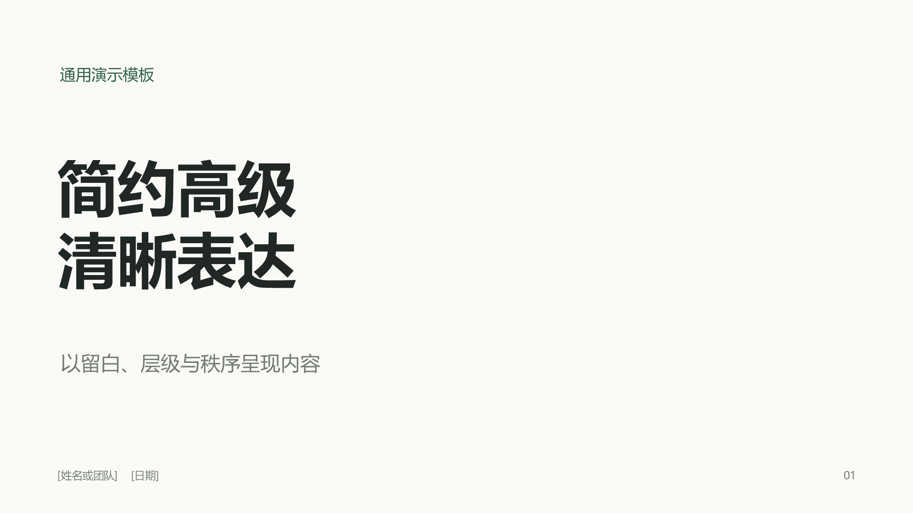
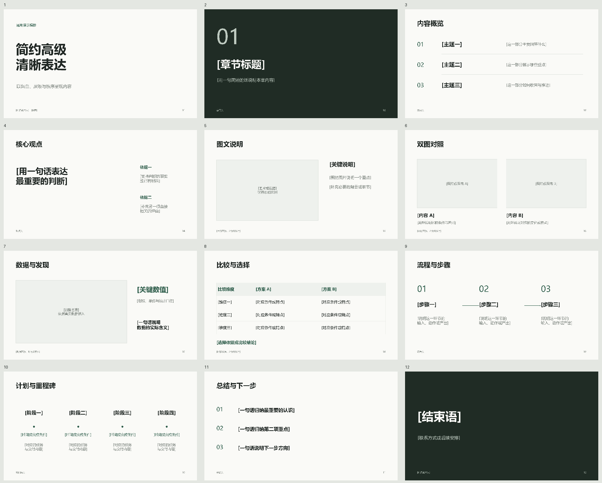

# 简约高级 PPT Skill

**Minimal Elegant PPT** — a reusable Agent Skill for clean, editable presentations.

用留白、清晰的字体层级和克制的配色，把不同主题的内容整理成可编辑PPT。适用于工作汇报、方案说明、教学分享、作品展示和学术报告。



## 设计与版式

米白与炭黑为基础，深绿少量强调。正文页保持干净，深色章节页和结束页形成适度节奏。没有固定的专业、页数、时长或讲述结构。

包含12种版式：封面、章节、目录、核心观点、单图说明、双图对照、数据展示、比较表、流程、时间线、总结和结束页。文字、比较表、流程与时间线均为原生可编辑对象，图片和数据区域使用占位框。



模板是一套版式库，不是必须填满的12页演示。可按内容选择、复制、删减或调整配色。

## 安装

下载 [最新安装包](https://github.com/sky-awe/minimal-elegant-ppt-skill/releases/latest)，解压后将整个 `minimal-elegant-ppt` 文件夹放入客户端支持的Skill目录，保持内部资源的相对位置。

在Codex中，也可以发送：

```text
请使用 Skill Installer，从 https://github.com/sky-awe/minimal-elegant-ppt-skill 安装 skills/minimal-elegant-ppt。
```

客户端如何发现和重新加载Skill，以其使用说明为准。仓库包含Codex界面元数据；其他Agent是否支持导入和导出PPTX取决于其环境。

## 使用

```text
使用 $minimal-elegant-ppt，根据这些材料制作一份项目进展汇报。
听众是团队成员，共10页。保持简约、留白充足，重点突出。
交付可编辑PPTX。
```

也可以用于已有PPT的风格整理：

```text
使用 $minimal-elegant-ppt 优化这份PPT。
保留主要内容，统一字体、配色和对齐，减少拥挤，放大关键图表。
```

页数、语言、强调色、PDF和演讲备注都可以按任务指定。Skill不强制研究生组会、论文原图、固定汇报时长、每页讲稿或每页引用。

## 文件与运行条件

- [`SKILL.md`](skills/minimal-elegant-ppt/SKILL.md)：通用内容适配、排版与交付规则。
- [`template.pptx`](skills/minimal-elegant-ppt/assets/template.pptx)：12页原生可编辑版式库。
- [`design-guide.md`](skills/minimal-elegant-ppt/references/design-guide.md)：配色、字号、页面用途和替换规则。
- `agents/openai.yaml`：Codex界面元数据与调用提示。
- `scripts/validate_skill.py`：仅使用Python标准库的发布包结构检查。

这是一个包含模板资产的Skill。使用环境仍需能够编辑和渲染PPTX；它不是独立的PPT软件，不自带模型API、字体或付费服务。默认使用微软雅黑，其他系统替换字体后需检查换行。数据图区域没有虚构或示范数字，生成实际图表需要用户提供真实数据。

## 验证

在仓库根目录运行：

```sh
python scripts/validate_skill.py
```

检查技能资源、PPTX关系、12页版式、12份备注提示、原生表格、图表占位框、流程连线和时间线节点。GitHub Actions运行相同检查。检查只验证发布模板的结构，不能代替生成后逐页视觉检查或内容核实。

此版本已在Microsoft PowerPoint中打开、渲染并逐页检查。没有宣称所有客户端均完成端到端测试。

## 版本与许可

v0.2.0起定位为通用的“简约高级 PPT Skill”，调用名为 `$minimal-elegant-ppt`。之前的组会版保留在 [v0.1.0历史版本](https://github.com/sky-awe/minimal-elegant-ppt-skill/tree/v0.1.0)，已安装旧版的用户需要安装新Skill才能使用新名称。

原创Skill说明、脚本与模板版式采用 [MIT License](LICENSE)。不包含原论文、私人研究记录或第三方字体。使用者后来加入的图片、字体与数据按各自许可处理。
