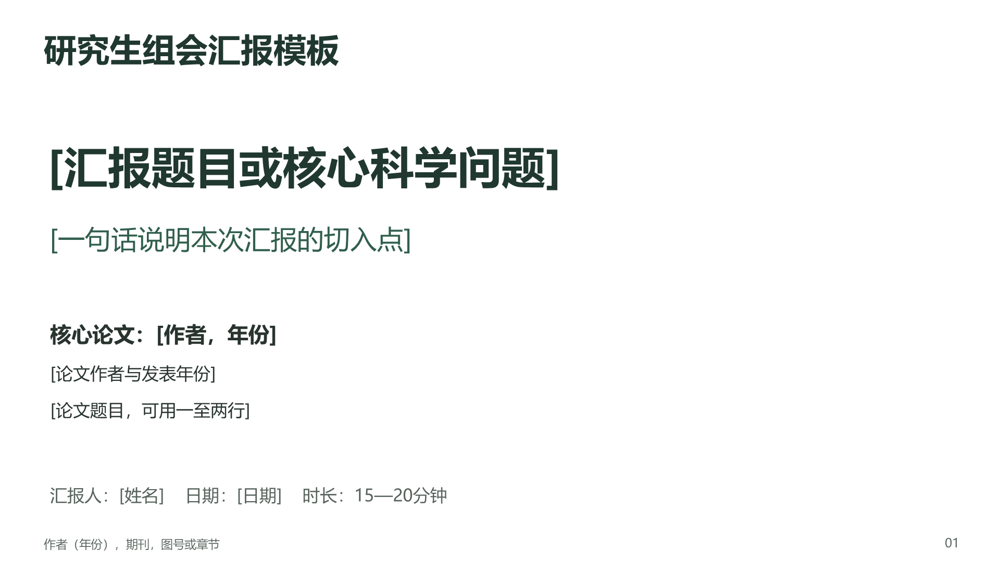

# 研究生组会 Research Seminar Skill

让AI沿用一套简洁的中文学术版式，将论文与笔记整理成可编辑的研究生组会PPT。



包含15页可编辑PowerPoint模板、中文演讲备注提示和面向学术证据的写作规则。白底深绿色、16:9，适合以原始论文图为中心讲清研究设计、趋势、幅度和科学含义。默认15—20分钟、约12—15页，不加备用页。

这是一个包含模板资源的Agent Skill，仍需运行环境具备阅读论文、编辑和渲染PPTX的能力。它不是独立的PPT生成软件，也不附带模型API、付费服务或字体。

## 安装与调用

将整个 `skills/research-seminar` 文件夹放入你的Agent支持的Skill目录，保持 `SKILL.md`、`references/`、`agents/` 与 `assets/` 的相对位置。目录应为：

```text
<你的Skill目录>/research-seminar/SKILL.md
```

在Codex中，也可以调用内置Skill Installer，直接发送：

```text
请使用 Skill Installer，从 https://github.com/sky-awe/research-seminar-skill 安装 skills/research-seminar。
```

安装位置和重新加载方式以你使用的客户端为准，参见 [OpenAI官方技能文档](https://learn.chatgpt.com/docs/build-skills)。

安装后提供论文、笔记或可访问的文件路径，输入：

```text
使用 $research-seminar，根据我提供的论文和笔记制作中文组会PPT。
汇报15—20分钟，核心论文为主，对照论文最多1页。
结果页优先使用论文原图，解释趋势、实际幅度和科学含义。
每页附自然易懂的中文演讲备注，交付可编辑PPTX和PDF。
```

修改某次汇报时，可以要求“保留这份PPT的版式，只优化第8—10页的原图讲解”。修改长期模板时，编辑 `assets/template.pptx` 及相应设计说明，更新预览后再校验。请在副本上制作新汇报。

## 文件与能力

- [`SKILL.md`](skills/research-seminar/SKILL.md)：可复用工作流与证据边界。
- [`template.pptx`](skills/research-seminar/assets/template.pptx)：15页可编辑模板，含封面、概念、采样、流程、结果、对照与讨论版式。
- [`design-guide.md`](skills/research-seminar/references/design-guide.md)：配色、字号、页面用途及替换规则。
- `agents/openai.yaml`：Codex界面元数据。
- `scripts/validate_skill.py`：仅用Python标准库检查发布包和PPTX结构。

文本、两张表格和采样/方法图解为原生可编辑对象。所有论文结果图均已替换为占位框。唯一保留的字母圆点图是明确标注的概念教学示例，不代表实测数据。正式生成的成品应使用用户提供的真实图表并清除占位提示。

模板要求区分作者报告、作者解释和汇报者评价，避免将空间代时间讲成连续监测、把未显著讲成完全不变、把功能潜力讲成过程速率，或把参照相似性讲成恢复完成率。

## 验证与兼容性

在仓库根目录执行：

```sh
python scripts/validate_skill.py
```

检查技能资源引用、PPTX包结构、15页/15份备注、两张原生表、占位图框以及未打包的媒体和外部关系。它不验证新论文的科学结论，也不能代替逐页视觉检查。GitHub Actions自动执行同一结构检查。

发布前模板已在Microsoft PowerPoint打开并逐页检查。默认使用微软雅黑；字体未随仓库分发，其他平台可能替换字体，需要重新检查换行。其他Agent的实际调用方式和PPTX导出能力取决于其客户端。本仓库不宣称经过所有客户端的端到端测试。

## 许可与材料范围

本仓库原创Skill说明、辅助脚本及模板版式采用 [MIT License](LICENSE)。公开版移除了私人汇报中的论文原图、具体论文题录、研究记录与个人路径。原论文、原图、用户后续加入的研究数据及第三方字体不属于本许可的授权范围；使用者应按其原有许可处理。
